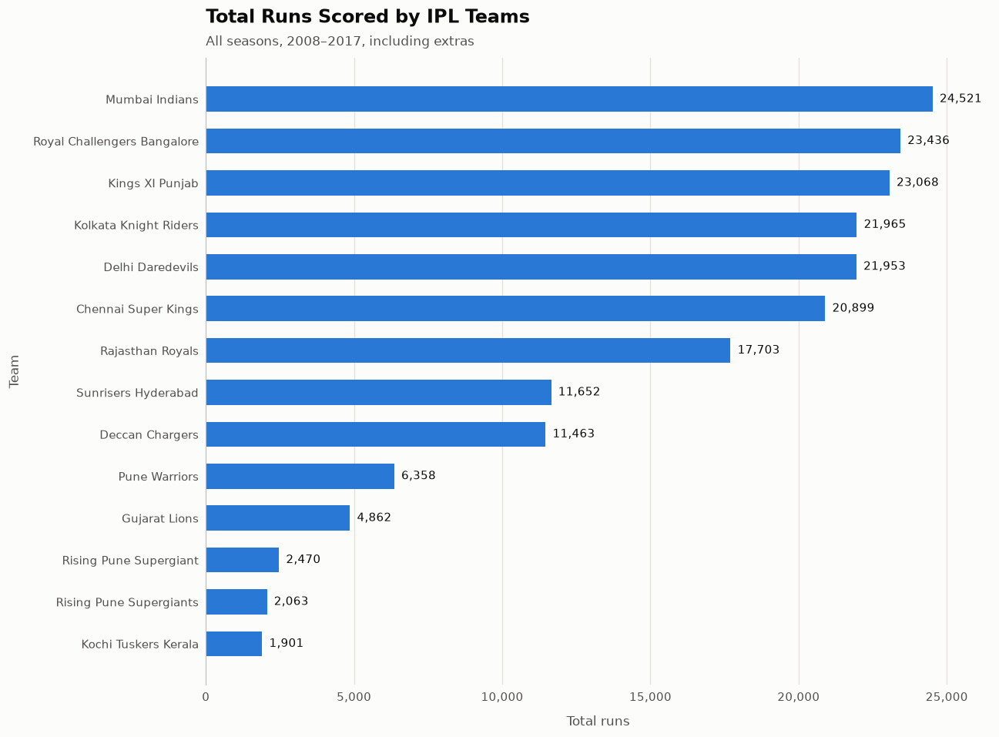
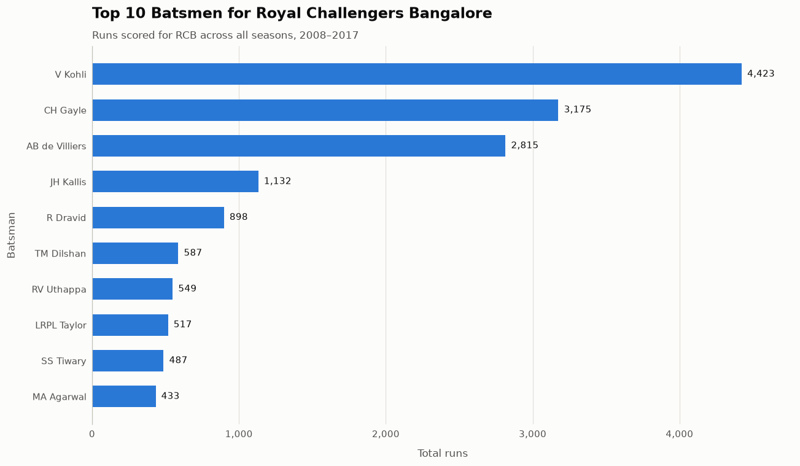
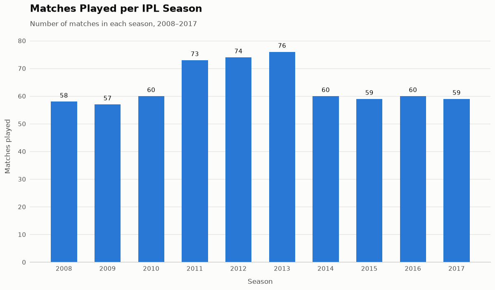
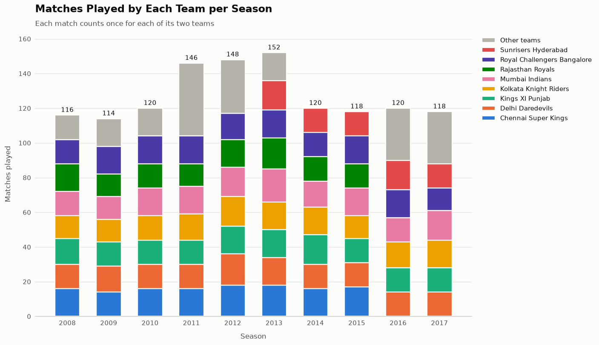
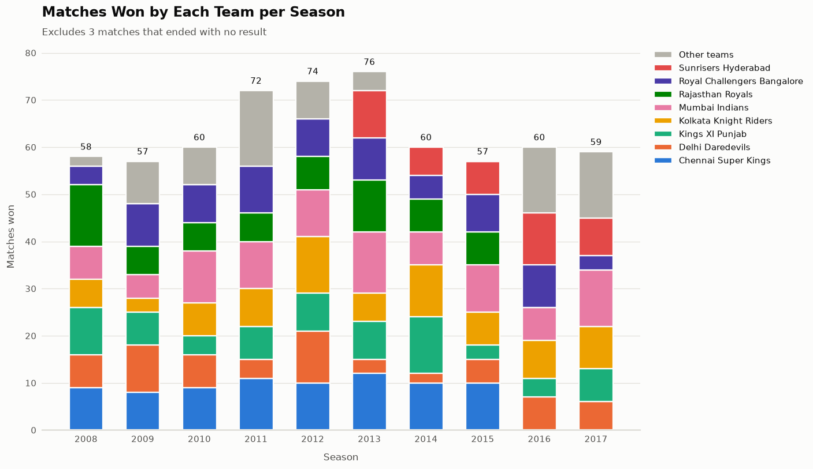
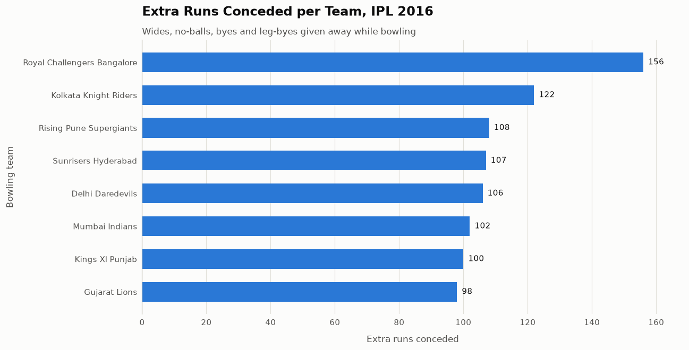
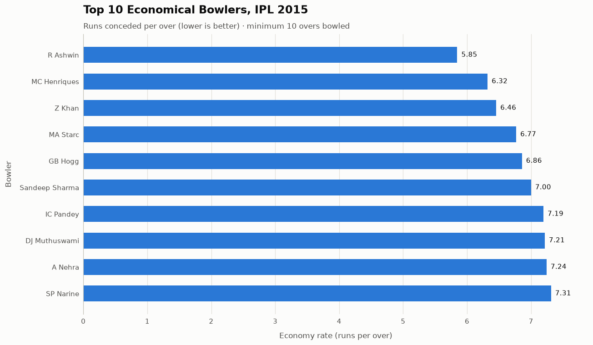

# IPL Data Analysis

Analysis of ball-by-ball Indian Premier League (IPL) cricket data from 2008 to 2017, using plain Python and matplotlib.

The project reads two CSV files, calculates team, batting and bowling statistics using only core Python (lists, dicts and loops, without pandas), and plots each result as a chart.

## Dataset

| File | Rows | Contents |
|---|---|---|
| `data/matches.csv` | 636 | One row per match: season, teams, toss, result, winner, venue |
| `data/deliveries.csv` | 150,460 | One row per ball bowled: batsman, bowler, runs, extras, dismissals |

## Charts

### 1. Total runs scored by each team
All runs (including extras) scored by each team across every season.



### 2. Top 10 batsmen for Royal Challengers Bangalore
Runs scored for RCB by each batsman across IPL history.



### 3. Matches played per year
Number of matches in each IPL season.



### 4. Matches played by each team per season
Stacked bar chart of matches each team played, by season. Each match counts once for each of its two teams.

The eight long-running franchises each have their own color. The six short-lived ones (Deccan Chargers, Kochi Tuskers Kerala, Pune Warriors, Gujarat Lions, Rising Pune Supergiant/s) are grouped as "Other teams", because more than eight colors in one chart become hard to tell apart.



### 5. Matches won by each team per season
Stacked bar chart of matches each team won, by season, with the same team colors. Matches that ended with no result are excluded.



### 6. Extra runs conceded per team in 2016
Wides, no-balls, byes and leg-byes given away by each bowling team in the 2016 season.



### 7. Top 10 economical bowlers in 2015
Bowlers with the lowest economy rate (runs conceded per over) in the 2015 season, among bowlers with at least 10 overs.

Economy rate follows the standard cricket definition: byes and leg-byes are not charged to the bowler, and wides and no-balls don't count as balls bowled.



## Requirements

- Python 3.12+

## Setup

```bash
# 1. Clone the repo and enter the folder
git clone <repo-url>
cd ipl-project

# 2. Create and activate a virtual environment
python3 -m venv .venv
source .venv/bin/activate        # Windows: .venv\Scripts\activate

# 3. Install dependencies
pip install -r requirements.txt
```

## Usage

```bash
python main.py
```

Each chart opens in its own window. Close it to see the next one.

## Project Structure

```
ipl-project/
├── main.py                  # Entry point: loads data, shows each chart
├── data/
│   ├── matches.csv
│   └── deliveries.csv
├── src/
│   ├── data_loader.py       # Reads the CSVs
│   ├── plotting.py          # Shared chart style and chart helpers
│   ├── teams.py             # Team groups and their fixed color order
│   └── ...                  # One module per chart
├── images/                  # Chart images used in this README
└── requirements.txt         # Python dependencies
```

## Adding Dependencies

When you install a new package, add it to `requirements.txt` so others get it too:

```bash
pip install <package>
pip freeze > requirements.txt
```
